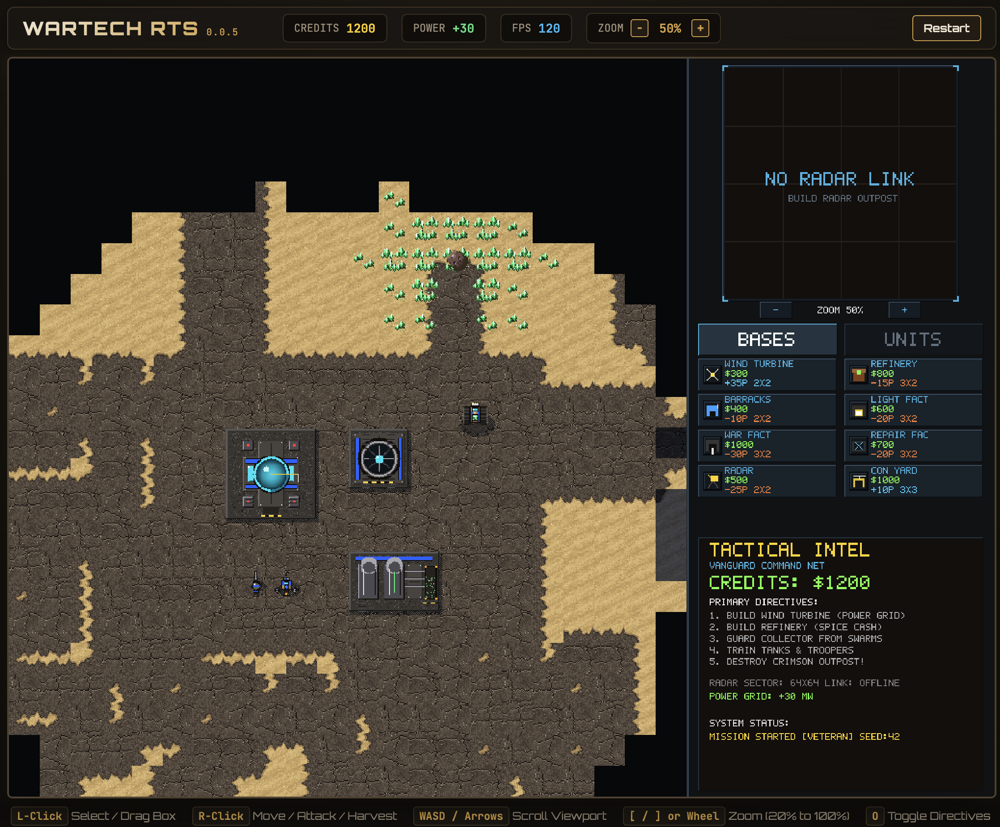

# WarTech RTS

Howdy fellow adventurer! I ported this from my bespoke WasmCoffee compiler to something a little
more mainstream.  Yes, the art sucks, I'm not an artist, but the game is playable, you can tinker
with it if you know a bit of Java and make it dance the way you want.

As an aside, some of the Java code might look weird, it's probably because I'm trying to lean into
more modern Java 25 features, and sometimes I have to revert back to something simpler because of
how GC-heavy some things are. Like streams. I had some streams and it was nice to reason over, until
I noticed the massive GC churn it created in a game at high framerates. So I walked it back to good
old loops. 

Play it in your browser: [WarTech](https://ewaldhorn.github.io/wartech/)

Made by [Ewald Horn](https://nofuss.co.za/) — check out my other [toys](https://nofuss.co.za/toys/).



## Why this is

It's an experiment, a learning journey and a bit of fun, all rolled into one. I really like Java as
a language, but it can be tedious to build "fun" stuff with it. Or at least, that used to be the case.
Being able to target the browser and the DOM opens up so many possibilities...

## AI Use

Yup. I use AI a lot. For research, for art, for refactoring, for helping me figure out what the heck
is wrong with my CSS. If you don't like it, that's perfectly fine, you do you. I take ownership of
what I put out, whether a junior or a bot did it, it's still on me. I wrote a lot of this myself, but
often I'd write the basics, create the skeleton and tell the bot to fill in the bits and bobs. 

Some of the documentation has been rewritten by AI because my spellink is adocius.

Rest assured, I remember to ALWAYS say "Make NO mistakes" in every prompt. So we're good bud!

## What this is

An old-school top-down 2d real-time strategy game for the browser, written in Java and compiled to 
WebAssembly GC with [TeaVM](https://teavm.org). We've got the Vanguard against the Crimson Syndicate 
campaign or skirmish against the AI on procedural maps.  Ok, not that procedural but it's a little 
bit. Maps need a lot of work.  Actually, everything needs a lot of work. You have the source, 
you do it!

I render the game to a 1024x768 old-school sized canvas, with a tactical view and a command menu. 
There's base building, economy and power management as well as, of course, combat units.

## Controls

I am working on touch/mobile/tablet support, it's got a few annoying bugs still. It seems to work
alright on desktop, though a trackpad kind of sucks. Zoom sort of works now, but it can jump around
a tad bit.

| Input | Action |
|---|---|
| Left click / drag | Select unit, building, or drag a selection box |
| Right click | Move / attack / harvest order at cursor |
| `Ctrl+1`–`Ctrl+9` | Assign selection to group 1–9 |
| `Ctrl+0` | Remove selection from its group |
| `1`–`9` | Select group; press again to center on it |
| WASD / arrow keys | Scroll viewport |
| `[` / `]` or `-` / `+` or mouse wheel | Zoom 20%–100% |
| `O` | Toggle objectives tracker |
| `Enter` / `Space` | Confirm / deploy from setup and briefings |
| `Esc` | Cancel placement, drag, or selection |
| Touch: tap / drag | Select / selection box |
| Touch: long press or two-finger tap | Right-click order |

## Build and run

You need JDK 25+, Maven 3.9+ for the core build, the actual game.
Python 3 to rebuild assets, only if you change stuff.
Tests need Node.js 22+ and Chrome, but who tests these days?

```sh
./build-dist.sh   # mvn package + stage a static docs/ folder
./serve.sh        # serve docs/ at http://127.0.0.1:8080/ (supposed to build it if needed)
```

Then open http://127.0.0.1:8080/ in a recent browser with WebAssembly GC. No app server needed, 
`docs/` contains just static files and can be hosted just about anywhere.

`PORT=9000 ./serve.sh` overrides the port. 
`build-dist.sh` prints the module sizes when done, because, why not?

## Tests

```sh
node test/browser_check.cjs [dir] [seconds] [chrome-binary]
# defaults: docs, 4s, /Applications/Google Chrome.app/... (or $CHROME)
node test/input_tour.cjs [dir] [stage|all] [chrome-binary]
# stages: 1 = setup + deploy + battlefield input, 2 = skirmish card, 3 = campaign + briefing
./test-sim.sh
# clean-builds the JVM classes, compiles SimCheck, and runs it; exit 0 = pass
```

`test-sim.sh` always rebuilds from clean as a stale build is just annoying. 

The check serves `docs/` over HTTP, drives headless Chrome over CDP, and asserts: the TeaVM module
boots (`window.__wartechReady`), a Space keypress deploys from the setup screen to the battlefield,
the viewport shows real sprite variety (≥60 distinct colors guards against solid-block rendering),
and no console errors or uncaught exceptions occur. HUD values and canvas pixel stats are logged
for inspection. Screenshots land in `test/out/` (`screenshot.png`, `battlefield.png`).

The input tour drives mouse, wheel, and keyboard events through CDP: every setup screen
control, the deploy button, selection, drag-box, right-click orders, zoom keys (asserted via the
HUD readout), camera keys, and the campaign briefing confirm. Each stage runs in a fresh browser;
any console error or uncaught exception fails the tour.

The sim check runs the simulation headless on the JVM (no browser, no framework) and asserts
gameplay invariants on a fixed seed: a unit ordered out of a map corner travels instead of
wedging on the edge, the enemy AI lays nothing but a Construction Yard while its yard is down,
and at most one AI foundation is ever in flight while the yard stands. It also pins the unit
traits declared in `UnitType` (rocket projectiles, turret mounts, which chassis leave wrecks),
so a dropped flag fails this test. Exit 0 passes, anything else means you messed up.

## Project layout

```
index.html            HUD DOM, canvas, TeaVM loader 
assets_data.js        Generated pixel payload (base64); committed, see below for why this exists
assets/sprites/       Source art for terrain, units, buildings. All PNG files, change as you want, remember to rebuild assets!!
src/main/java/wartech/  Java sources (`wartech.*` packages, standard Maven layout)
  core/               WarTech (sim state + wasm_* API), Surface, InputController + UnitOrders/SetupInput, Camera, Memory, Rng, Faction, KeyCode, MouseButton
  bridge/             BrowserApp (TeaVM entry, canvas/input bindings, frame loop, HUD, campaign saves)
  render/             Viewport/Sidebar/Dossier/Screen renderers, RenderShared (pixel helpers), Palette, BitmapFont (5x7/6x9/8x11 pixel text), AssetData (decoded sprites)
  unit/               Unit, UnitType, UnitNavigation, UnitSpatialGrid
  building/           Building, BuildingType, ProductionSystem
  combat/             CombatEngine, Projectile, Effect, ThreatSystem, Wreckage
  ai/                 EnemyAI + economy/production/defense/assault/retreat/roster/build-order/census/tuning/stations
  map/                GameMap, MapSize
  campaign/           CampaignManager, ObjectiveEvaluator, CampaignData, CampaignMission, CampaignSave
pom.xml               Maven + TeaVM (WEBASSEMBLY_GC) build, Java 25 minimum required
build-dist.sh         Build + stage dist/
serve.sh              Static server for dist/
tools_convert_assets.py  PNG -> assets_data.js (see Asset pipeline)
test/browser_check.cjs   Headless end-to-end check (above)
test/input_tour.cjs      Headless input tour: setup, deploy, orders, briefing (above)
test/sim/SimCheck.java   Headless sim invariants: corner escape, AI yard gate, AI pipeline (above)
target/ test/out/        Git-ignored build/test outputs
```

## Game Architecture

### Simulation

At the core of it, this is a simulation. You have an economy going, power management and of course
the combat units. Oh and there's some wildlife too.  In order to try and avoid GC as much as possible,
I opted for fixed-size entity pools, which get recycled depending on the unit state. The idea is to
not have the game loop allocate memory if it doesn't need to. 

I use deterministic randomness so that I can test stuff properly. Towards that end, I have two RNGs
that I use, one for the sim and one for FX. Funny enough, `fxRng` is for FX, guess the sim one...

The core of this game consists of just plain Java code. In fact, you can run the sim headless, for
tests, which is pretty handy to find nasty bugs.

### Rendering

Basically, I render it all via software onto a 1024x768 32-bit frame buffer which gets blitted using
`putImageData` per frame right at the end of the `update()` call. This gives pretty alright FPS and
it's a lot of fun as well.

Colors are packed `0xAABBGGRR` because wasm is little-endian! Handy knowing that, because at first
my colours looked super weird.

### Browser stuff

By default, Java doesn't give a hoot about the browser. Initially, I had this building via [WasmCoffee](https://wasmcoffee.com/),
but nobody wants to use that crap. So I ported it to [TeaVM](https://teavm.org/), which is a really cool
project.

Bridge: `main` in `bridge/BrowserApp` is the TeaVM entry point. 
It handles everything we need to communicate to and from the browser from the internal state.

- Configures the canvas handle
- Sets up input bindings for mouse/touch/wheel/keyboard for our `core/InputController`
- Sets up the animation frame loop
- Handles `localStorage` campaign persistence
- A few `@JSBody` bindings for canvas rect, `document.hidden`, ready flag etc.

### Assets

Sprites are just PNG files under `assets/sprites/`, with tiles and units 64×64 pixels and 
buildings `widthTiles*64` × `heightTiles*64` as declared in `BuildingType`. 
`tools_convert_assets.py` packs them (in `AssetData.java` declaration order) into the base64 blob 
in `assets_data.js`, which the game Base64-decodes at boot. 

The generated file is committed so normal builds don't need Python/PIL; the converter reproduces 
and should fail on missing art or size mismatches.

### Campagin saves

I use `wartech_rts_campaign_save` with version stamp `wartech_rts_save_version` (`"2"`). 

Old-version or `?reset_campaign` / `?clearsave` loads wipe progress at first boot. 
Victories should automatically save your progress. 

Remember to bump `CampaignSave.CURRENT_VERSION` when the format changes, or the game will have 
issues as it will try to load an incompatible save file.

## Updating the game

### Adding or changing graphics
1. Add the PNG
2. Declare the `int[]` in `AssetData.java` and append its decode loop in  `loadFromBytes` (same order)
3. Run `python3 tools_convert_assets.py` to rebuild the assets

### Adding a new unit or building
1. Extend `UnitType` or`BuildingType` (remember to add sprites as above if needed)
2. Edit `WarTech.UNIT_ORDER` `BUILD_ORDER`, the AI build lists, and any faction mirrors.

### Bumping the version
1. Change `<version>` in `pom.xml`. The build step will update the `BuildVersion` class, which, 
in turn, should update the game version in the `index.html` file upon load success.

## Troubleshooting

- Blank page or "doesn't support WebAssembly GC": use a current browser, `file://` won't load `.wasm`, must serve over HTTP.
- `no module in docs` from the check: run `./build-dist.sh` first, but the script should have done this.
- Chrome not found: pass the binary path or set `$CHROME`, tests couldn't find the headless browser.

## Have fun

Thanks for reading, hope you have fun building your own Java stuff!

---
